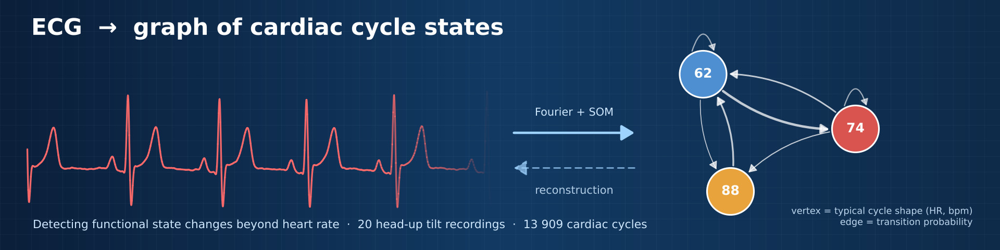
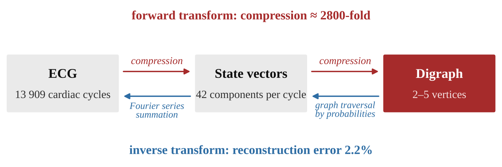
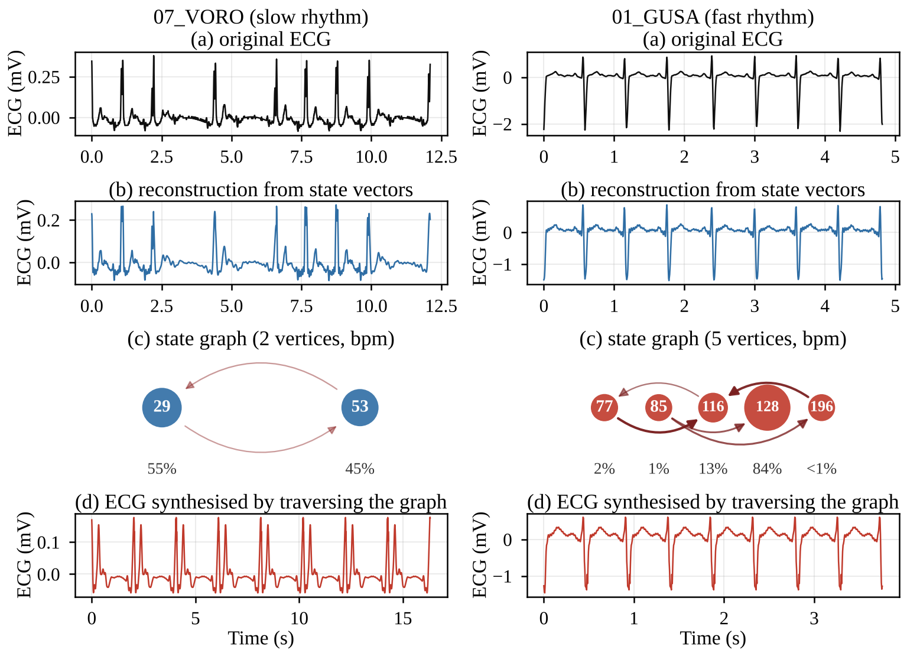

<p align="center">
  
</p>

<h1 align="center">Graph of cardiac cycle states</h1>
<p align="center"><b>for detecting functional state changes in the electrocardiogram</b></p>

<p align="center">
  
  
  
  
  
</p>

<p align="center">
  <b>English</b> · <a href="README_RU.md">Русский</a>
</p>

---

## What this is

A long-term ECG is turned into a **weighted directed graph**. Each cardiac cycle is expanded into a
partial Fourier series; the coefficient vectors are clustered by a self-organising map; the cluster
centres become the **vertices** (typical cycle shapes) and the transition frequencies between
consecutive cycles become the **edges**. The graph describes neither single beats nor the whole
recording, but the **switching between functional states** — what both beat-by-beat classification
and integral heart rate variability indices leave out.

Every vertex stays an interpretable cardiac cycle: it can be reconstructed and shown to a clinician,
and traversing the graph synthesises a plausible ECG.

<p align="center">
  
</p>

## Key results

20 passive head-up tilt recordings (rest → 45° tilt), lead II, 500 Hz, 13 909 cardiac cycles.

| Analysis | Shift across the tilt | Within-phase control | Subjects | p (paired Wilcoxon) |
|---|:---:|:---:|:---:|:---:|
| State vector with cycle duration | 0.50 ± 0.29 | 0.15 ± 0.10 | 15 / 20 | 2.6 × 10⁻⁴ |
| Without cycle duration | 0.54 ± 0.29 | 0.15 ± 0.11 | 15 / 20 | 2.6 × 10⁻⁴ |
| Fixed window, independent of RR | 0.70 ± 0.28 | 0.10 ± 0.09 | 19 / 20 | 1.9 × 10⁻⁶ |

| Quantity | Value |
|---|---|
| SDNN, rest → tilt | 55.7 → 60.0 ms, p = 0.143 (no significant change) |
| State stability, rest → tilt | 0.71 → 0.79, p = 0.009 |
| Cycle reconstruction from the state vector | 2.2 ± 0.6 % of the signal range |
| R-wave amplitude, boundary at R / shifted by 40 % RR | −18.3 ± 5.0 % / −9.9 ± 5.4 % |
| Compression of a recording into its graph | ≈ 2800-fold |
| Robustness | 5 random seeds, 6 and 20 harmonics, SOM vs k-means — conclusion unchanged |

Every number of the paper is in [`paper-2026/results/numbers.txt`](paper-2026/results/numbers.txt).

<p align="center">
  
</p>

## Quick start

```bash
git clone https://github.com/MyProfile-projects/ecg-graph-representation.git
cd ecg-graph-representation
pip install -r paper-2026/requirements.txt

# everything: numbers, tables, figures (about 3-4 min; --fast skips the robustness runs, about 1 min)
python paper-2026/code/build_all.py --data . --roh PATH_TO_ROHMINE_RECORDINGS --out my_results
```

* `--data .` — the 20 tilt-test recordings `0011_ecg.edf … 0030_ecg.edf` in the repository root.
* `--roh` — optional: the four ROHMINE test-database recordings (see *Data*). Without them the
  test-database analysis, Figure 5 and Supplementary Table S3 / Figure S2 are skipped.
* Russian figure labels: set `FIG_LANG=ru` before the command
  (`set FIG_LANG=ru` in Windows cmd, `$env:FIG_LANG="ru"` in PowerShell).
* Independent check of the R-wave detection with a second detector (wavelet + Shannon energy):
  `python paper-2026/code/wtsee_check.py --data .`

## Repository layout

```
ecg-graph-representation/
├── 0011_ecg.edf … 0030_ecg.edf      20 anonymised tilt-test recordings (EDF+, 3 leads, 500 Hz)
├── paper-2026/                       ← the current version of the paper
│   ├── code/
│   │   ├── build_all.py              entry point: recordings → numbers, tables, figures
│   │   ├── ecg_graph.py              core methods: annotation, Fourier state vectors, SOM, graphs
│   │   ├── figures.py                figures at true print size (English or Russian labels)
│   │   ├── wtsee.py, wtsee_check.py  second R-wave detector and the comparison
│   ├── results/
│   │   ├── numbers.txt / .json       every number quoted in the paper
│   │   ├── tables/                   Tables 1–2, Supplementary Tables S1–S3 (CSV, LaTeX)
│   │   ├── figures/                  Figures 1–5, S1–S2 (PDF, PNG)
│   │   └── figures_ru/               the same figures with Russian labels
│   ├── supplementary/                Supplementary material (English and Russian)
│   └── requirements.txt
└── *.ipynb, *.py, series.pkl         earlier version of the analysis (see below)
```

| Paper | File |
|---|---|
| Figure 1 — annotation of P, R, T waves | `results/figures/fig1.pdf` |
| Figure 2 — scheme of the phase comparison | `results/figures/fig2.pdf` |
| Figure 3 — state occupancy shift vs within-phase control; state stability | `results/figures/fig3.pdf` |
| Figure 4 — forward and inverse transforms | `results/figures/fig4.pdf` |
| Figure 5 — full transformation cycle on two recordings | `results/figures/fig5.pdf` |
| Table 1 — annotation accuracy on synthetic ECG | `results/tables/table1.csv` |
| Table 2 — cardiac cycle parameters by test phase | `results/tables/table2.csv` |

## Data

* **Tilt test** — 20 anonymised recordings in the repository root: 5 min supine rest, then a 45° tilt
  for 5 min; leads I, II, III at 500 Hz; test phases are marked by EDF+ annotations. The study
  protocol was approved by the Ethics Committee of the National Medical Research Center for Therapy
  and Preventive Medicine (Protocol No. 02-01/24, 12 March 2024); all subjects signed consent forms.
* **Test database** — four recordings of the test database of the Russian Society of Holter
  Monitoring and Noninvasive Electrophysiology (ROHMINE), distributed by the society at
  [rohmine.org](https://rohmine.org); they are not redistributed here.

## Earlier version

The notebooks and scripts in the repository root (`article_code.ipynb`, `article_code_ENG.ipynb`,
`ecg_graph_full.py` and others) belong to an **earlier version of the analysis** and are kept for
reference. Their numbers differ from the current paper: the current code excludes ectopic and
artefactual RR intervals before the variability indices, measures wave amplitudes from the
isoelectric PQ segment, and adds the within-phase control. **Use `paper-2026/` to reproduce the paper.**

## Citation

The paper is under review; the reference will be added here after publication.
