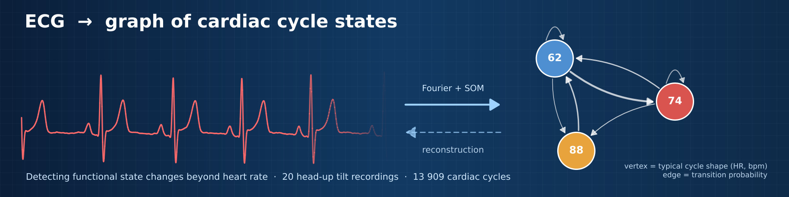
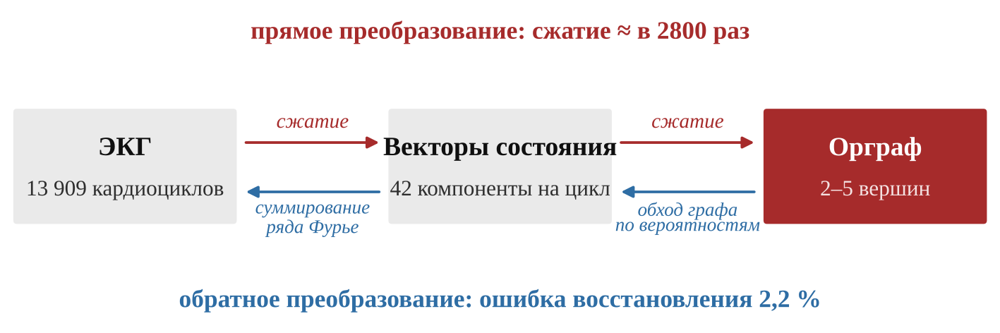
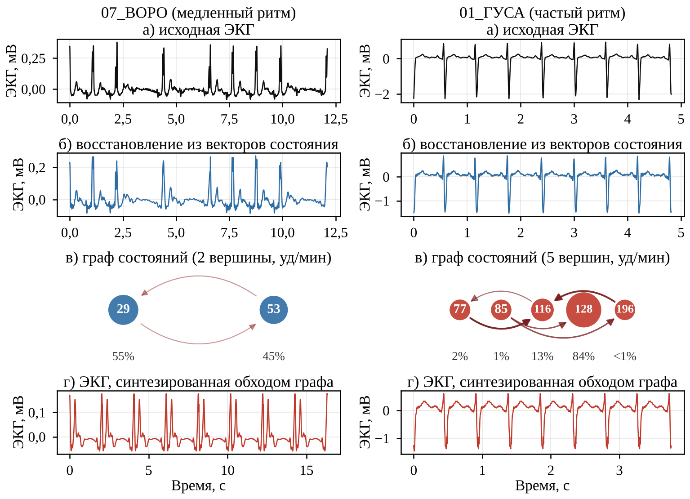

<p align="center">
  
</p>

<h1 align="center">Граф состояний кардиоцикла</h1>
<p align="center"><b>для выявления смены функционального состояния по электрокардиограмме</b></p>

<p align="center">
  
  
  
  
  
</p>

<p align="center">
  <a href="README.md">English</a> · <b>Русский</b>
</p>

---

## О чём это

Длительная ЭКГ преобразуется во **взвешенный ориентированный граф**. Каждый кардиоцикл
раскладывается в частичный ряд Фурье, векторы коэффициентов кластеризуются самоорганизующейся
картой Кохонена; центры кластеров становятся **вершинами** графа (типичными формами кардиоцикла),
а частоты переходов между последовательными циклами — его **рёбрами**. Граф описывает не отдельные
сокращения и не запись в целом, а **смену функциональных состояний** — то, что теряется и при
покардиоцикловой классификации, и в интегральных показателях вариабельности сердечного ритма.

Каждая вершина остаётся интерпретируемым кардиоциклом: его можно восстановить и показать врачу,
а обход графа порождает правдоподобную ЭКГ.

<p align="center">
  
</p>

## Основные результаты

20 записей пассивной ортостатической пробы (покой → наклон 45°), отведение II, 500 Гц, 13 909 кардиоциклов.

| Анализ | Межфазный сдвиг | Внутрифазный контроль | Обследуемых | p (критерий Уилкоксона) |
|---|:---:|:---:|:---:|:---:|
| Вектор состояния с длительностью цикла | 0,50 ± 0,29 | 0,15 ± 0,10 | 15 / 20 | 2,6 · 10⁻⁴ |
| Без длительности цикла | 0,54 ± 0,29 | 0,15 ± 0,11 | 15 / 20 | 2,6 · 10⁻⁴ |
| Фиксированное окно, не зависящее от RR | 0,70 ± 0,28 | 0,10 ± 0,09 | 19 / 20 | 1,9 · 10⁻⁶ |

| Показатель | Значение |
|---|---|
| SDNN, покой → наклон | 55,7 → 60,0 мс, p = 0,143 (значимо не изменился) |
| Стабильность состояний, покой → наклон | 0,71 → 0,79, p = 0,009 |
| Восстановление цикла из вектора состояния | 2,2 ± 0,6 % размаха сигнала |
| Амплитуда R, граница на пике R / сдвиг на 40 % RR | −18,3 ± 5,0 % / −9,9 ± 5,4 % |
| Сжатие записи в граф | ≈ в 2800 раз |
| Устойчивость | 5 инициализаций, 6 и 20 гармоник, карта Кохонена и k-средних — вывод не меняется |

Все числа статьи — в файле [`paper-2026/results/numbers.txt`](paper-2026/results/numbers.txt).

<p align="center">
  
</p>

## Как запустить

```bash
git clone https://github.com/MyProfile-projects/ecg-graph-representation.git
cd ecg-graph-representation
pip install -r paper-2026/requirements.txt

# всё сразу: числа, таблицы, рисунки (3–4 мин; с ключом --fast без проверок устойчивости — около 1 мин)
python paper-2026/code/build_all.py --data . --roh ПАПКА_С_ЗАПИСЯМИ_РОХМиНЭ --out my_results
```

* `--data .` — 20 записей ортостатической пробы `0011_ecg.edf … 0030_ecg.edf` в корне репозитория.
* `--roh` — необязательно: четыре записи тестовой базы РОХМиНЭ (см. «Данные»). Без них пропускаются
  анализ тестовой базы, рисунок 5, таблица S3 и рисунок S2.
* Русские подписи на рисунках: перед командой задайте `FIG_LANG=ru`
  (`set FIG_LANG=ru` в командной строке Windows, `$env:FIG_LANG="ru"` в PowerShell).
* Независимая проверка выделения R-зубцов вторым детектором (вейвлет + энергия Шеннона):
  `python paper-2026/code/wtsee_check.py --data .`

## Структура репозитория

```
ecg-graph-representation/
├── 0011_ecg.edf … 0030_ecg.edf      20 обезличенных записей ортостатической пробы (EDF+, 3 отведения, 500 Гц)
├── paper-2026/                       ← актуальная версия статьи
│   ├── code/
│   │   ├── build_all.py              точка входа: записи → числа, таблицы, рисунки
│   │   ├── ecg_graph.py              основные методы: разметка, векторы Фурье, карта Кохонена, графы
│   │   ├── figures.py                рисунки в печатном размере (английские или русские подписи)
│   │   ├── wtsee.py, wtsee_check.py  второй детектор R-зубцов и сравнение
│   ├── results/
│   │   ├── numbers.txt / .json       все числа, приведённые в статье
│   │   ├── tables/                   таблицы 1–2 и S1–S3 (CSV, LaTeX)
│   │   ├── figures/                  рисунки 1–5, S1–S2 (PDF, PNG), английские подписи
│   │   └── figures_ru/               те же рисунки с русскими подписями
│   ├── supplementary/                дополнительные материалы (на английском и русском)
│   └── requirements.txt
└── *.ipynb, *.py, series.pkl         прежняя версия анализа (см. ниже)
```

## Данные

* **Ортостатическая проба** — 20 обезличенных записей в корне репозитория: 5 мин покоя лёжа, затем
  наклон 45° на 5 мин; отведения I, II, III, 500 Гц; этапы пробы отмечены аннотациями EDF+. Протокол
  исследования одобрен этическим комитетом ФГБУ «НМИЦ терапии и профилактической медицины» Минздрава
  России (протокол № 02-01/24 от 12 марта 2024 г.); все обследуемые подписали информированное согласие.
* **Тестовая база** — четыре записи тестовой базы Российского общества Холтеровского мониторирования
  и неинвазивной электрофизиологии (РОХМиНЭ), которую распространяет общество:
  [rohmine.org](https://rohmine.org). Здесь эти записи не выкладываются.

## Прежняя версия

Ноутбуки и скрипты в корне репозитория (`article_code.ipynb`, `article_code_ENG.ipynb`,
`ecg_graph_full.py` и др.) относятся к **прежней версии анализа** и сохранены для справки. Их числа
отличаются от статьи: в текущем коде перед расчётом вариабельности исключаются эктопические
и артефактные RR-интервалы, амплитуды зубцов измеряются от изоэлектрического сегмента PQ,
добавлен внутрифазный контроль. **Для воспроизведения статьи используйте папку `paper-2026/`.**

## Как цитировать

Статья находится на рецензировании; ссылка появится здесь после публикации.
